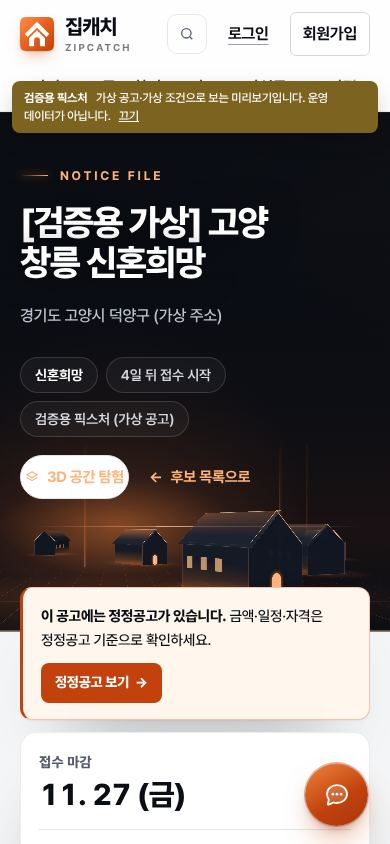
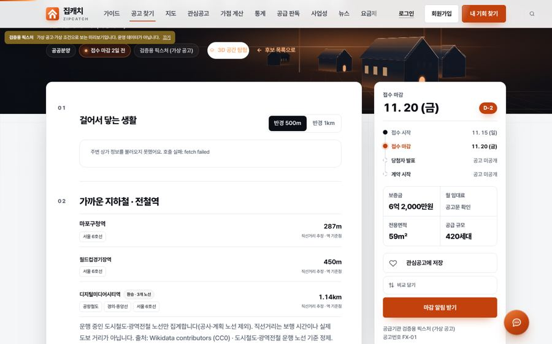

# 정확도 감사 — 열린 PR #30·#31·#32 와 운영 데이터 (2026-11-18)

기준: `main` `1a73616`(운영 배포와 같음) + #30 `4c8b2c4` + #32 `babad77` + #31 `ceab657`.
운영 상태는 운영 배포의 공개 API(`/api/notices/map`, `/api/notices/{id}`)를 읽어서 봤다. 운영 DB 에는 쓰지 않았다.

## 1. 운영에서 실제로 본 것

| 항목 | 값 |
|---|---|
| 지금 열린 공고 | 127건(좌표 없음 1) |
| 위치 등급 | 주소 좌표 43 · 공고명 좌표 49 · 시군구 2 · 시도 32 |
| 수집 | 2026-11-17 23:34 UTC 정상(신규 45 · 출처 3곳) · 상태 FRESH |
| 런타임 오류(7일) | 1건 묶음 — `/api/me` 'JWT issued at future' 1회 |

### 같은 모집이 두 장으로 보이던 공고 — 5건

| 가려지는 공고 | 대신 서는 공고 | 이유 |
|---|---|---|
| 인천논현2단지 국임임대주택 예비입주자 모집 공고 | [정정공고]… | 정정 |
| 안산신길2 B-1블록 공공분양주택 입주자 모집공고 | [정정공고]… | 정정 |
| '26.11월 경주시, 영천시 국민임대주택 동호지정 … | [정정공고][정정공고]… (표시 겹침도 하나로) | 정정 |
| 양산시 국민임대주택 예비입주자 완화 모집('26.11.16)… | [정정공고]… | 정정 |
| 제천 영천동 행복주택 추가(예비)입주자 모집공고 (마이홈 18430-1, 2025-07 시작·당첨 발표 2025-10-14) | 같은 이름 (마이홈 21477-1, 2026-11-09 시작) | 이전 회차 |

규칙(`lib/consumer/supersede.ts`)
- 정정 표시(`[정정공고]`·`(재공고)` 등)는 괄호로 감싼 것만 읽는다.
- 정정 표시가 없으면 같은 제목에 주소·주택유형·보증금·월 임대료가 모두 같아야 같은 모집으로 본다.
- 주소가 없는 목록형 공고는 이름만 같다고 묶지 않는다.
- 아무것도 지우지 않는다. 목록·지도·달력에서는 한 장만 세운다. 가려진 공고는 링크로 그대로 열리고, 상세가 '정정공고가 있습니다 → 정정공고 보기'를 먼저 말한다.
- 금액만 다른 같은 단지(영주 매입임대 3건)나 유형만 다른 같은 단지(평창장평 고령자형·일반형)는 합치지 않는다. 시험으로 고정했다.

## 2. #32 역 데이터(위키데이터) 감사

| 결함 | 예 | 처리 |
|---|---|---|
| 여객 역이 아닌 점 | 청량신호소 · 대관령신호장 · 남강릉신호장 | 제외 |
| 노선 오배정 | 연신내 = 2호선(실제 3·6호선·GTX-A). 이촌·옥수·응봉·왕십리 = 1호선(실제로는 경의·중앙선이 다님) | 제외·경의·중앙선으로 옮김 |
| 영문·옛 이름 | Gyodae · Geoje · Daejeo · '지하철 영등포역' · '건국대역' | 교대 · 거제 · 대저 · 영등포 · 건대입구 |
| 광역전철 아닌 구간 | 경강선 만종~강릉(KTX 6역) · 서해선 서화성·안중·인주 · 1호선 대광리·신탄리 | 제외 |
| 빠진 역 | 경의·중앙선 57역 중 17역만 있었음 · 수원·천안·병점·평택지제·온양온천·신창 · 2호선 신정지선 · 동해선 울산 구간 | 위키데이터 검색으로 46역 추가. 화전·강매·서빙고 3역은 노선 구간 안에서 하나로 정해지지 않아 넣지 않고 `unresolved` 로 남김 |
| 빠진 환승 노선 | 청량리·서울·중랑·망우 경의·중앙선, 서울 GTX-A, 까치산 2호선, 수원 수인·분당선 등 | 기존 좌표에 노선만 추가 |

교정 규칙은 `scripts/spatial/build_stations.py` 의 `apply_corrections` 에 있다. 다시 빌드해도 같은 교정이 적용된다.
재빌드는 GitHub Actions 의 `transit-stations` 워크플로가 맡는다(이 작업 환경에서는 위키데이터가 막혀 있다).
결과: 1,027개 기록 → 1,072개 기록(`transit-v1.1`).

운영의 열린 공고 127건에서 역세권 계산 결과는 교정 전과 같았다. 정상 11 · 반경 밖 32 · 위치 미확인 산정 제외 83.
교정의 효과는 앞으로 들어올 수원·파주·남양주·양평·울산 공고에서 나타난다.

## 3. 그 밖의 감사 메모(코드 변경 없음)

- **#30 `NOTIFY_LIVE` 잠금**: 병합되면 `NOTIFY_LIVE=1` 을 넣기 전까지 운영 이메일이 PREVIEW 로만 쌓인다. 안전 쪽 변경이다. 실발송을 이어가려면 배포 환경변수가 필요하다.
- **#30 루틴 중첩 방지**: '최근 실행이 RUNNING 인가'를 본 뒤 시작한다. 같은 순간 두 요청이 겹치면 둘 다 지나갈 수 있어 완전한 잠금은 아니다(DB 고유 제약이 필요).
- **#30 중복 알림 차단**: 실패(FAILED)한 알림도 '보냄'으로 센다. 일시 오류로 못 간 알림은 다시 보내지 않는다. 이전 동작과 같아 바꾸지 않았다.
- **#32 LH 게시일**: `extractLhPublishedAt` 은 수집에 연결돼 있지 않다. `notice_published_at` 열은 이관(마이그레이션 초안) 전이라 운영 DB 에 없다. 지금 연결하면 적재가 실패한다. 이관을 적용한 뒤 연결해야 한다.
- **#32 역세권 패널**: 응답을 못 받았을 때 패널이 통째로 사라지던 것을 '불러오지 못했습니다'로 고쳤다. 반경 안에 역이 없을 때는 'KTX·일반열차만 서는 역은 세지 않습니다'를 덧붙였다.

## 4. 검증

- `npm test` 129/129 · `npx tsc --noEmit` 0 · ESLint(바뀐 파일) 0 · `npm run build` 통과.
- headless(Chromium, 미리보기 픽스처 — 가상 공고) 54/54. 결과는 `qa-results.json`, 스크립트는 `scripts/qa-accuracy.cjs`.
  - 목록: 정정공고만 서고 원공고·이전 회차는 숨는다. 1440·390 모두 확인.
  - 원공고 상세: 안내 → 단추를 누르면 정정공고로 간다. 정정공고 상세는 원공고를 대신한다고 밝힌다.
  - 역세권: 주소 좌표 공고는 역·노선·직선거리와 '직선거리 추정'을 함께 보여 준다. 위치 미확인 공고는 산정 제외 사유를 적는다(0m 없음). 경험칙 계수는 노출되지 않는다.
  - 비교: '가까운 역' 행이 있고, 위치 미확인 공고는 '주소 미확인(산정 제외)'로 적는다.
  - `/notices` · 상세 · `/compare` · `/map` · `/` 1440·390: 가로 넘침 0 · 페이지 오류 0.
- 미검증
  - 실기기(GPU·Safari).
  - 운영 DB 로 띄운 로컬 화면. 이 작업 환경에는 운영 DB 키가 없다. 운영 데이터는 공개 API 로만 읽었다.

