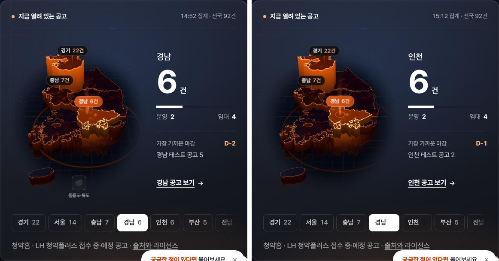
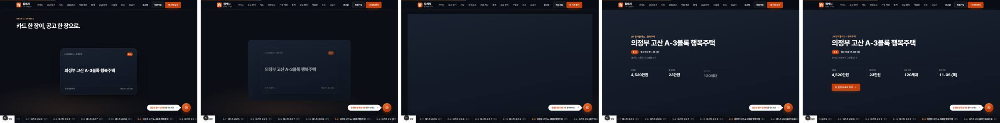
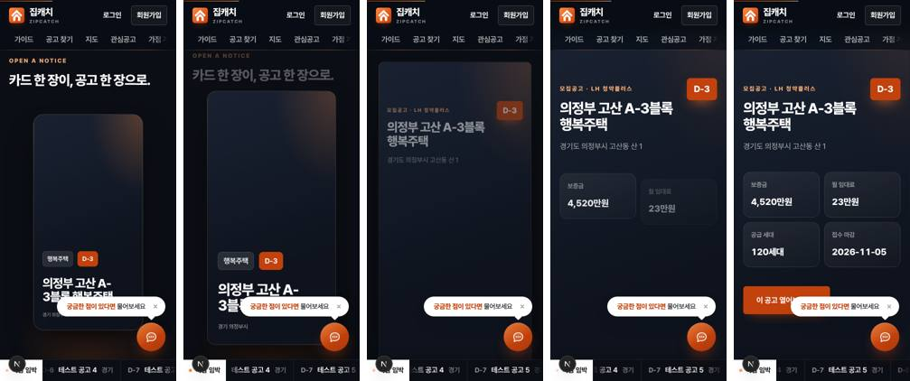
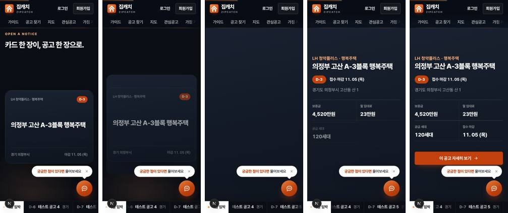

# ZIPCATCH 4.0 추가 — 지도 정리 · 공고 확대 장면 재설계

작성 2026-10-28 · 브랜치 `claude/zealous-brahmagupta-haeec2` · PR yubinxe/zipcatch#15 (초안, 미머지)

스크린샷의 공고·지도 숫자는 **픽스처(가짜 응답)** 다. 화면 모양을 보려고 만든 값이며 실제 공고가 아니다.

## 1. 수정한 파일

| 파일 | 변경 |
|---|---|
| `components/consumer/HeroAtlas.tsx` | 울릉도·독도 인셋(`IslandInset`) import·렌더 제거 |
| `components/consumer/home/OpenNoticeScene.tsx` | 확대 장면 마크업 재구성 — 판(sheet) / 카드 얼굴(face) / 문서(doc) 세 층, 작은 카드 비율 측정(ResizeObserver), 제목·상태·지역·조건·CTA 순차 등장 |
| `app/consumer-immersive.css` | `.cs-open*` 전면 교체, 쓰이지 않던 `.cs-open-in` 애니메이션 삭제, 좁은 화면·낮은 화면 규칙 |
| `app/consumer-refine.css` | 캐러셀 카드 제목 줄바꿈 규칙(keep-all·balance), 인셋 CSS 설명을 공급 지도용으로 고침 |
| `lib/korea-map-data.ts` | 주석만 — 섬 데이터는 경북 경로에 그대로, 인셋은 공급 지도만 씀 |

## 2. 삭제한 UI와 보존한 데이터

- **삭제:** 첫 화면 지도의 '울릉도·독도' 작은 상자 하나.
- **보존:**
  - 경북 경로 안의 울릉도·독도 형상, 전국 공고 집계, 지역 코드, 3D 지도의 원거리 섬 처리.
  - `IslandInset` 컴포넌트와 `KOREA_ISLAND_INSET`·`KOREA_ISLAND_PROVINCE` 상수, `.cs-isle` CSS. 공급 지도(`SupplyMap`)가 계속 쓰므로 지우지 않았다.
  - `KOREA_VISUAL_VIEWBOX` 는 그대로 두었다. 렌더링해 보니 본토·제주가 칸 안에 고르게 앉아 있었다.

## 3. 공고 확대 장면 — 단계별

| 단계(진행률) | 이전 | 이후 |
|---|---|---|
| A 0~18% 작은 카드 | 화면 전체 크기 판을 0.4배(모바일 0.62배)로 줄여 보여 줌. 모바일에서는 화면 비율을 따라 **세로로 길쭉한 카드**가 됐고, 제목은 줄인 큰 글씨라 답답했음 | 카드를 실제 크기(데스크톱 560×340, 모바일 화면폭−40×≤290)로 그림. 위에 출처·유형과 마감, 가운데 제목(최대 3줄·균형 줄바꿈), 아래에 지역과 마감일. 판은 가로·세로를 따로 줄여 카드 모양을 맞춤 |
| B 18~58% 넓어짐 | 선형으로 커짐. 큰 주황 방사광 | smoothstep 곡선(시작·끝 부드럽게). 모서리는 축마다 보정해 둥근 모양 유지. 낮은 채도의 앰버 빛이 transform 으로만 천천히 이동. 카드 얼굴이 40% 즈음 걷힌 뒤 문서 제목이 들어와 두 제목이 겹치지 않음 |
| C 48~80% 정보 | 4개 칸이 반투명 유리 카드로 동시에 가까이 등장 | 출처·유형 → 제목 → 마감 표지와 '접수 마감 날짜' → 주소 → 조건 4칸 순서. 진행률 3~5%씩 간격(스크롤 연동). 조건은 유리 카드 대신 괘선 격자(데스크톱 4열·모바일 2×2), 숫자 tabular-nums |
| D 78~100% 행동 | '이 공고 열어보기' | '이 공고 자세히 보기 →'. 높이 52px(낮은 화면 48px), 호버 시 화살표만 3px 이동, 눌림 1px. 한 번 나타나면 끝까지 그대로 |

- 마감 표지는 홈 캐러셀 카드와 같은 규칙을 쓴다. 사흘 이내면 주황으로 채우고, 그 밖에는 옅은 빛 표지다. 날짜 표기도 캐러셀·상세와 같은 `11. 05 (목)` 형식이다.
- 값이 없으면 기존 의미를 그대로 둔다. 보증금·임대료는 '공고문 확인', 마감일은 '미정'이다.

## 4. 모바일

- 390px: 카드 비율이 바로잡혔다(세로로 길쭉함 → 가로가 넓은 카드). 조건은 2×2이고 CTA는 전체 폭이다.
- 320×640 · 375×667 · 390×600(낮은 화면): 처음에는 작은 카드가 장면 제목과 겹쳤다. 카드를 44px 내려 앉혀 고쳤다.
- 낮은 화면에서 긴 제목은 위가 잘렸다. 위에서부터 채우도록 `justify-content: safe center` 를 쓰고, 제목을 세 줄로 제한해 고쳤다. 전체 제목은 `title` 속성과 상세 화면에 있다.
- 모든 크기에서 가로 넘침은 0이다. 마지막 장면에서 CTA는 화면 안에 있다(예: 390×600 에서 442~490px).

## 5. 캐러셀 · 상세 연결

- **캐러셀 동작은 고치지 않았다.** 코드로 확인한 것은 다음과 같다.
  - 6초 자동 넘김, 마우스 끌기만 직접 처리하고 터치는 기본 스크롤에 맡김(세로 스크롤과 충돌 없음).
  - 손을 대면 멈춤, 끝에서는 어두워졌다 처음으로 돌아감.
- **바꾼 것은 제목 줄바꿈 하나다.** 'A-3블록' 같은 이름이 낱말 가운데서 끊기지 않게 했다.
- 상세 화면은 이미 같은 이름·주소·유형·상태·출처·마감일을 머리에 보여 준다. 그래서 바꾸지 않았다. 쓰이지 않던 `.cs-open-in` 애니메이션은 지웠다.
- View Transitions 는 도입하지 않았다. 라우팅이 복잡해지는 것에 비해 얻는 것이 작다고 봤다.

## 6. 성능 · 접근성

- 스크롤 진행률은 `ScrollStage` 가 rAF 로 계산해 CSS 변수(`--p`)에 적는 구조 그대로다. React 는 스크롤마다 다시 그리지 않는다.
  - React 가 도는 때는 카드 크기 비율을 잴 때뿐이다(크기 변화 시).
- 움직이는 속성은 다음과 같다.
  - 판: transform + border-radius. 반지름이 바뀌어 판 한 장은 다시 칠해진다.
  - 빛: transform.
  - 글: opacity·transform.
  - 이전에 있던 box-shadow 연속 변경과 배경 그라디언트 위치 변경은 없앴다.
- 헤드리스 측정에서 스크롤 중 프레임 간격 중앙값은 33ms, p95는 33.5ms였다. GPU 없는 환경이라 **실기기 성능은 미검증**이다.
- **접근성 확인 결과**
  - 움직임 줄이기: 확대 과정 없이 완성된 문서가 보인다(390px 캡처 확인).
  - 키보드: 진행률 25% 에서 Tab 으로 CTA 에 들어가면 문서가 즉시 다 보이고(불투명도 1), 카드 얼굴은 숨고 판은 다 열린다.
  - 카드 얼굴은 `aria-hidden` 이다. 같은 내용을 문서가 한 번만 읽힌다.
  - 공고가 0건이면 장면 자체가 없다(확인).

## 7. 필수 통과 조건

| # | 조건 | 결과 |
|---|---|---|
| 1 | 홈 지도 인셋 제거 | 통과(`.cs-atlas .cs-isle` 0개, 7개 크기) |
| 2 | 본토·제주 중심 정렬 | 통과(캡처 확인) |
| 3 | 2D→3D 화면 밀림 없음 | 통과 — 평면·캔버스가 같은 칸(329×397). **남은 점:** 3D는 기울어진 시점이라 같은 칸에서 지도가 약 15~20% 커 보이고, 700ms 교차 페이드로 넘어간다. 3D 카메라 폭 상한을 줄여 봤지만 세로 조건이 먼저 걸려 효과가 없어 되돌렸다 |
| 4 | 확대 중 가로 스크롤 없음 | 통과(320~1440) |
| 5 | 제목·금액·마감 겹침 없음 | 통과(짧은 제목·긴 제목 픽스처) |
| 6 | 공고 없을 때 빈 장면 없음 | 통과 |
| 7 | 상세 링크 | 통과(`/notices/{id}`) |
| 8 | 짧은 화면 CTA 접근 | 통과(390×600, 320×640) |
| 9 | 자동 캐러셀 유지 | 코드 변경 없음 · 캡처 정상 |
| 10 | 움직임 줄이기에서 정보 전체 | 통과 |

- 품질 검사: `tsc` · ESLint(변경 파일) · `npm test` 26/26 · `next build` 통과. 13개 화면 경로 200(프로덕션 빌드)이다.
- 실데이터·실기기·Safari 는 미검증이다.

## 8. 남은 일 · 승인

- Preview 에서 실제 공고로 확대 장면을 확인해 주세요. 특히 실제 긴 공고명과 '공고문 확인' 값이 섞인 경우를 봐 주시면 됩니다.
- 프로덕션 반영(main 머지)은 승인 후에 합니다.
- 다음 순서는 4.0 실거래 흐름의 실데이터 검증, 그다음 Hermes·n8n·Atelier 연동 설계입니다.
